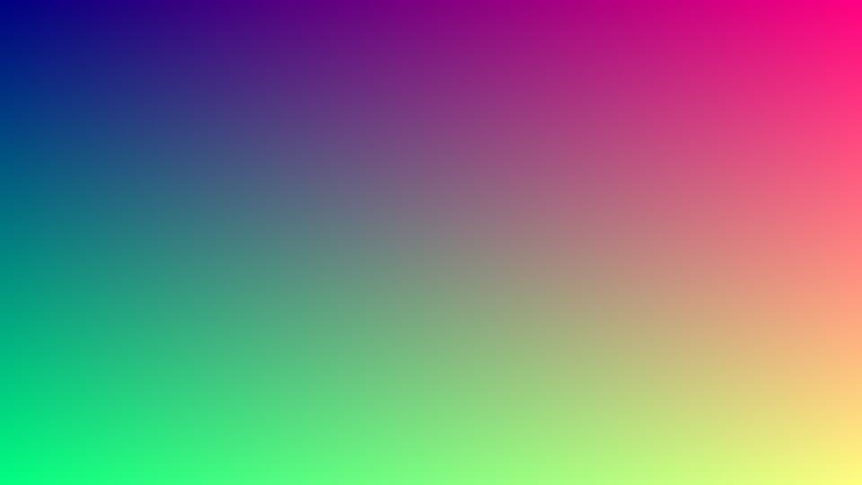

# Soft Rasterizer

不依赖任何图形 API 的软件光栅化渲染管线（C++17）。SDL2 只负责开窗、收输入、
把 CPU 的 framebuffer 当纹理贴到窗口上——所有顶点变换、裁剪、光栅化、深度测试、
插值和着色都是自己写的。

> 按《软光栅渲染器技术指导》的 D0–D14 日程推进，进度见文末。



## 构建与运行

```bash
brew install cmake ninja sdl2     # 只做一次
cmake --preset release            # 配置：检测 SDL2，在 build/ 生成 Ninja 工程
cmake --build --preset release    # 编译链接
./build/soft_raster               # 运行：S 存图，ESC 或关窗退出
```

产物：`build/soft_raster`、`out.tga`（当前帧）。

## 目录

```
src/
├── main.cpp              入口：开窗 / 主循环 / 输入
├── math/                 Vec/Mat/投影——D1 起填充
├── core/
│   ├── framebuffer.*     颜色 + 深度缓冲，clear / setPixel / 导出 TGA
│   ├── texture.*         纹理采样与 mipmap——D3/D8
│   └── camera.*          轨道相机——D4
├── pipeline/
│   ├── vertex.h          Vertex / VSOut / SVert——D1/D2
│   ├── shader.h          着色器接口——D3
│   ├── rasterizer.*      裁剪 → 光栅化 → 插值 → 片元——D2/D5
│   └── renderer.*        组织一次 draw call——D2
├── scene/                Mesh / OBJ 加载 / 场景——D4
└── platform/
    └── window_sdl.*      SDL 只在这一层出现
tests/  bench/  assets/  docs/
```

CMake 把渲染核心编成 `sr_core`（**不链接 SDL**），可执行文件 `soft_raster` 只多出
`platform/window_sdl.cpp`。这样后面的 `test_all` 和 `bench` 都能在没有窗口的机器上跑。

## 进度

| 天 | 目标 | 状态 |
| --- | --- | --- |
| D0 | 环境 + CMake + 空窗口 + framebuffer 导出 TGA | ✅ |
| D1 | 数学库 + 画线 + 线框立方体 | |
| D2 | 边函数光栅化 + 深度缓冲 + 背面剔除 | |
| D3 | 透视校正 + 纹理 + Blinn-Phong | |
| D4 | OBJ + 场景 + 轨道相机 + 实时窗口 | |
| D5 | 近平面裁剪 + 单元测试 | |
| D6 | benchmark + 第一波优化 | |
| D7 | 多线程 tile 渲染 | |
| D8–D14 | mipmap / 抗锯齿 / 阴影 / 文档 / demo / 模拟面试 | |

开发过程记录在 [docs/devlog.md](docs/devlog.md)。

## 已知限制

- 目前只有 D0：画面是固定渐变，还没有几何管线。
- 窗口尺寸固定（960×540），D4 做缩放时再重建纹理。
