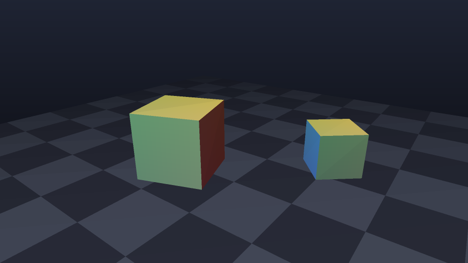
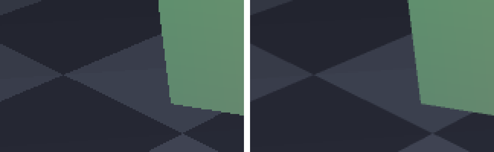

# soft_raster

纯 CPU 的软件光栅化器。SDL2 只做一件事：把 `Framebuffer::color` 上传成纹理贴到窗口上。
所有顶点变换、三角形填充、深度测试、着色都在 `src/main.cpp` 里手写完成。



## 构建与运行

```bash
cmake --preset release        # 首次
cmake --build build           # 之后每次

./build/soft_raster                       # 开窗口，实时旋转
./build/soft_raster --dump out.ppm --time 0.9   # 离屏渲染一帧（PPM，可用 sips 转 PNG）
./build/soft_raster --bench 300           # 测平均帧耗时
```

命令行参数：

| 参数 | 作用 |
| --- | --- |
| `--dump <文件.ppm>` | 离屏渲染一帧并写文件（不需要窗口/显示器） |
| `--time <秒>` | 离屏渲染使用的动画时间 |
| `--size <宽> <高>` | 分辨率，默认 960×540 |
| `--ssaa <倍数>` | 超采样抗锯齿倍数，默认 2，`1` 关闭 |
| `--wireframe` | 只画三角形边线 |
| `--no-cull` | 关闭背面剔除（配合深度测试观察遮挡） |
| `--bench <帧数>` | 连续离屏渲染，打印 ms/帧 |

运行时按键：`SPACE` 线框、`C` 背面剔除、`A` 抗锯齿、`R` 重置动画时间、`ESC` 退出。

## 管线

```
模型空间 --model--> 世界空间 --view--> 相机空间 --projection--> 裁剪空间
        --透视除法--> NDC --视口变换--> 屏幕空间
        --边函数--> 覆盖的像素 --重心坐标--> 深度测试 + 透视校正插值 --> 颜色缓冲
```

`main.cpp` 按顺序分成几块：

1. **数学库**：`Vec3/Vec4/Mat4`（行主序、列向量）、`perspective`、`lookAt`、旋转/平移/缩放。
2. **帧缓冲**：`color`（`0xAARRGGBB`）+ `depth`（`[0,1]`，0 近 1 远）。
3. **光栅化**：`edgeFunction` 判左右侧；`rasterizeTriangle` 用三个边函数做覆盖率测试，
   像素中心采样，重心坐标线性插值 NDC z 做深度测试，颜色按 `1/w` 加权做透视校正插值。
4. **场景**：立方体（每个面独立四顶点，便于算面法线）、棋盘地板、两个旋转物体。
5. **着色**：面法线 + Lambert 主光 + 朝向相机的补光，再加距离雾。
6. **输出**：窗口模式（SDL 纹理）或离屏 PPM。

## 几个实现细节

- **正反面判定**：屏幕 y 轴向下，所以视口变换后正面三角形的有向面积为负，`area > 0` 即背面。
- **深度插值**：NDC z 是屏幕空间坐标的仿射函数，线性插值就是精确的；颜色必须走透视校正。
- **抗锯齿**：不做 MSAA，而是按 `ssaa` 倍分辨率整帧渲染后盒式降采样，改动最小、结果直观。

左：`--ssaa 1`（关闭）；右：默认 `--ssaa 2`（每像素 4 个子采样）：



## 已知限制 / 下一步

- 没有近平面裁剪：顶点跑到相机后面时整个三角形被丢弃，下一步应在裁剪空间做 Sutherland–Hodgman 裁剪。
- 没有纹理与 UV 采样（透视校正插值已经具备，可直接复用到 UV）。
- 单线程、无 SIMD、无分块（tile）优化；边界框按三角形整体包围盒遍历。
- 无阴影、无多光源。
