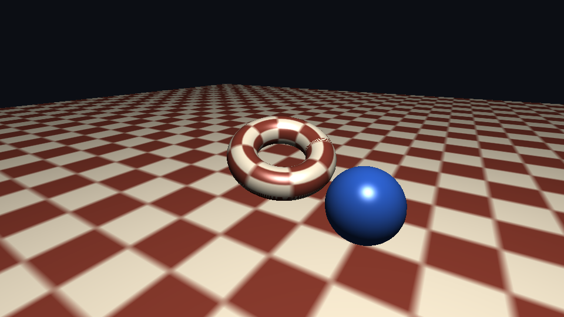
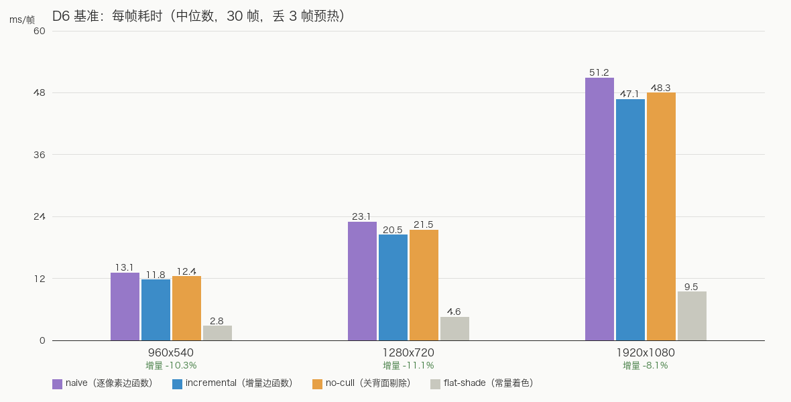
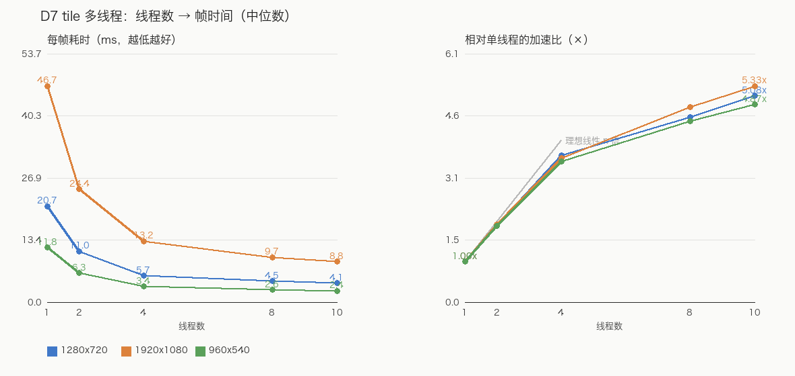

# Soft Rasterizer

不依赖任何图形 API 的软件光栅化渲染管线（C++17）。SDL2 只负责开窗、收输入、
把 CPU 的 framebuffer 当纹理贴到窗口上——所有顶点变换、裁剪、光栅化、深度测试、
插值和着色都是自己写的。

> 按《软光栅渲染器技术指导》的 D0–D14 日程推进，进度见文末。



## 构建与运行

```bash
brew install cmake ninja sdl2     # 只做一次
cmake --preset release            # 配置：检测 SDL2，在 build/ 生成 Ninja 工程
cmake --build --preset release    # 编译链接
./build/soft_raster               # 运行：左键拖动旋转，滚轮缩放，R 复位，S 存图，ESC 退出
```

产物：`build/soft_raster`、`out.tga`（当前帧）。

命令行开关（无窗口，方便出图和对照实验）：

```bash
./build/soft_raster --once --time 1.2            # 渲一帧导出 out.tga
./build/soft_raster --bench 60                   # 连渲 60 帧，报告 ms/帧
./build/soft_raster --model assets/torus.obj     # 换模型
./build/soft_raster --yaw 1.2 --pitch 0.5 --dist 8   # 指定机位（可复现的截图）
./build/soft_raster --no-spec --no-normalize     # 关高光 / 关法线归一化，做对照
./build/soft_raster --dist 0.5 --no-clip         # 凑近看近平面裁剪：--no-clip 退回 D4 的"整片丢弃"
./build/soft_raster --threads 4 --tile 32        # 光栅化线程数 / tile 边长（默认用满硬件线程 + 32）
```

基准测试（输出 CSV，再画成图）：

```bash
./build/bench --frames 30 --csv docs/bench_d7.csv    # 3 档分辨率 × 8 个 variant
python3 tools/plot_bench.py   docs/bench_d7.csv docs/images/d6_bench.png
python3 tools/plot_threads.py docs/bench_d7.csv docs/images/d7_threads.png
```

单元测试（纯 C++，不需要 SDL 窗口，也不需要显示器）：

```bash
cmake --build --preset release && ./build/test_all   # 直接跑，退出码非 0 即有失败
ctest --test-dir build --output-on-failure           # 或走 CTest
```

**要在仓库根目录运行**：`assets/torus.obj` 是相对路径。模型加载失败时会提示并回退到程序化立方体。

## 目录

```
src/
├── main.cpp              入口：开窗 / 主循环 / 输入
├── math/                 Vec/Mat/投影——D1 起填充
├── core/
│   ├── framebuffer.*     颜色 + 深度缓冲，clear / setPixel / 导出 TGA
│   └── texture.*         双线性采样 + Wrap::Repeat——D3/D4
├── pipeline/
│   ├── vertex.h          Vertex / VSOut / SVert——D1/D2
│   ├── shader.h          IShader 接口 + Blinn-Phong——D3
│   ├── clip.*            近平面裁剪（齐次空间 Sutherland–Hodgman）——D5
│   ├── renderer.*        三阶段：顶点+裁剪 → 分箱 → 光栅化，带分阶段计时——D6/D7
│   ├── tiles.*           tile 分箱（CSR）+ 常驻线程池——D7
│   └── rasterizer.*      光栅化 → 插值 → 片元——D2/D6
├── scene/
│   ├── mesh.h             Mesh + 程序化立方体/地面/球
│   ├── primitives.cpp
│   ├── obj_loader.*       Wavefront OBJ 解析
│   ├── camera.h           轨道相机
│   └── demo_scene.*       演示场景（地面 + 圆环 + 球），窗口和 bench 共用
└── platform/
    └── window_sdl.*      SDL 只在这一层出现
tests/                    单元测试（数学 / 光栅化 / 裁剪 / 采样 / 分箱）
bench/                    bench.cpp：CSV 输出 + 分阶段计时
tools/                    gen_obj.py、plot_bench.py、plot_threads.py
assets/  docs/
```

CMake 把渲染核心编成 `sr_core`（**不链接 SDL**），可执行文件 `soft_raster` 只多出
`platform/window_sdl.cpp`。这样后面的 `test_all` 和 `bench` 都能在没有窗口的机器上跑。

## 进度

| 天 | 目标 | 状态 |
| --- | --- | --- |
| D0 | 环境 + CMake + 空窗口 + framebuffer 导出 TGA | ✅ |
| D1 | 数学库 + 画线 + 线框立方体 | ✅ |
| D2 | 边函数光栅化 + 深度缓冲 + 背面剔除 | ✅ |
| D3 | 透视校正 + 纹理 + Blinn-Phong | ✅ |
| D4 | OBJ + 场景 + 轨道相机 + 实时窗口 | ✅ |
| D5 | 近平面裁剪 + 单元测试 | ✅ |
| D6 | benchmark + 第一波优化 | ✅ |
| D7 | 多线程 tile 渲染 | ✅ |
| D8–D14 | mipmap / 抗锯齿 / 阴影 / 文档 / demo / 模拟面试 | |

开发过程记录在 [docs/devlog.md](docs/devlog.md)。

## 性能

Apple **M4**（4 性能核 + 6 能效核，10 逻辑核），`-O3`，6496 三角形，无窗口渲染
（不含 `SDL_UpdateTexture` 上传）。每档 30 帧、丢 3 帧预热，报**中位数**。

**优化阶梯**（单线程，每次只加一项）：

| 分辨率 | naive（逐像素边函数） | 增量边函数 | 提升 | 纯光栅（常量着色） |
| --- | --- | --- | --- | --- |
| 960×540 | 13.1 ms | 11.8 ms | −10.0% | 2.9 ms |
| 1280×720 | 23.5 ms | 20.7 ms | −11.8% | 4.7 ms |
| 1920×1080 | 52.2 ms | 46.7 ms | −10.4% | 9.6 ms |



结论一：**瓶颈在片元着色，不在光栅化**。1080p 下 46.7 ms 里有 ~37 ms 是 Phong + 纹理采样
（占 80%），光栅化本身只有 9.6 ms。继续抠边函数收益见底，钱在着色那一侧。

**tile 多线程**（同一份场景，只改线程数）：

| 分辨率 | 1 线程 | 2 | 4 | 8 | 10（用满） | 加速比 |
| --- | --- | --- | --- | --- | --- | --- |
| 960×540 | 11.8 ms | 6.3 | 3.4 | 2.7 | **2.4 ms** | 4.86× |
| 1280×720 | 20.7 ms | 11.0 | 5.7 | 4.5 | **4.1 ms** | 5.09× |
| 1920×1080 | 46.7 ms | 24.4 | 13.2 | 9.7 | **8.8 ms** | 5.33× |



结论二：**加速比到 4 线程就基本到位**（3.4×），8 线程只再快 28%，10 线程只多 9%。
原因不是 Amdahl 意义上的串行代码——顶点 + 分箱实测只占 0.34 ms（0.7%）——
而是这台机器是**异构核**：4 个性能核 + 6 个能效核，能效核的单核吞吐低得多，
"再来两个核"换不回"再来一份 1/10 的算力"。用 Amdahl 拟合 10 线程的数据会得到
~10% 的"等效串行比例"，它把线程同步、内存带宽和能效核都折算进去了。

所有格子都是 `[x0,x1)` 半开区间，输出与线程数**逐字节相同**（1/2/4/8/10 线程的 TGA sha256 一致），
`tests/test_tiles.cpp` 里也守着这条。完整数据见 [docs/bench_d7.csv](docs/bench_d7.csv)。

## 已知限制

- 只裁了**近平面**。左右上下和远平面还没裁：画面外的三角形照样会进光栅化器，
  由包围盒 clamp 兜住（不会画错，只是白费一点时间）。屏幕很大时值得补上。
- 窗口尺寸固定（960×540），缩放要重建纹理。
- 多线程只并行光栅化；顶点变换和分箱还是单线程（占 0.7%，暂时不值得并行）。
- 着色器仍是虚函数逐片元调用，还没上模板化/SoA——这是下一档优化的位置。
